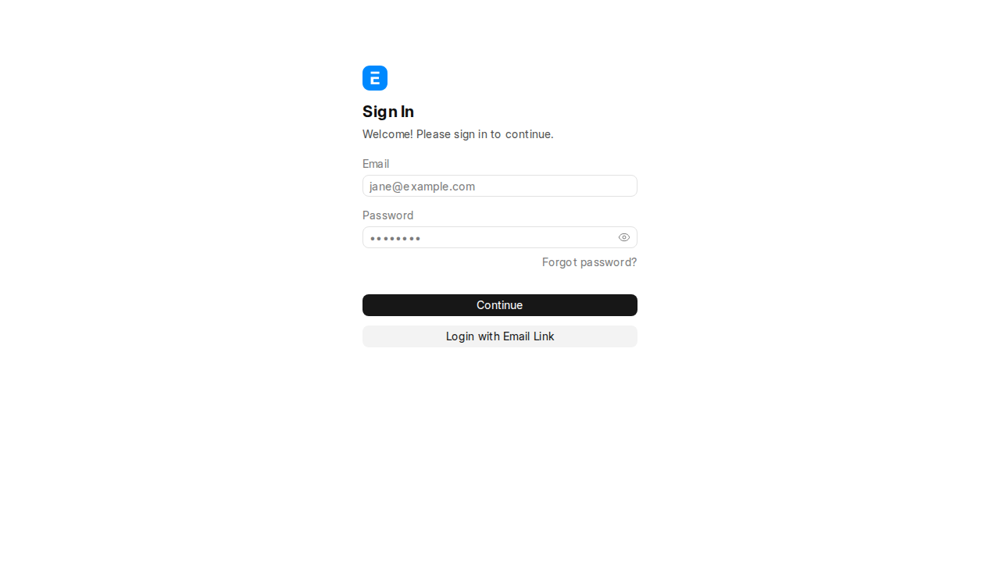
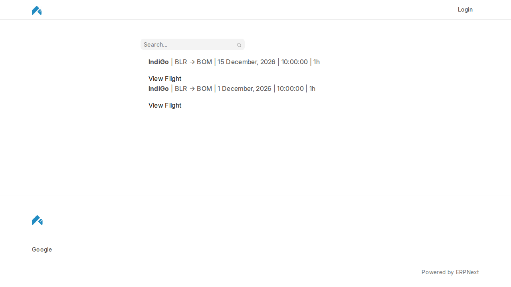
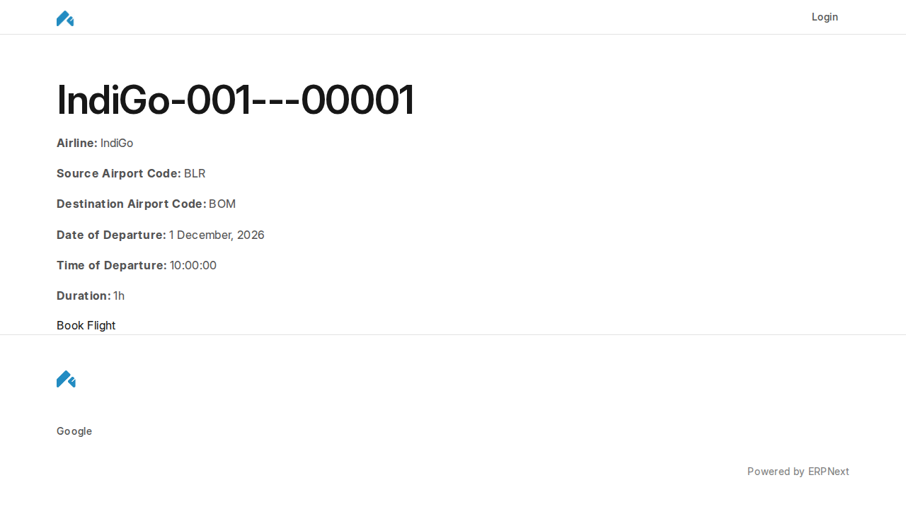
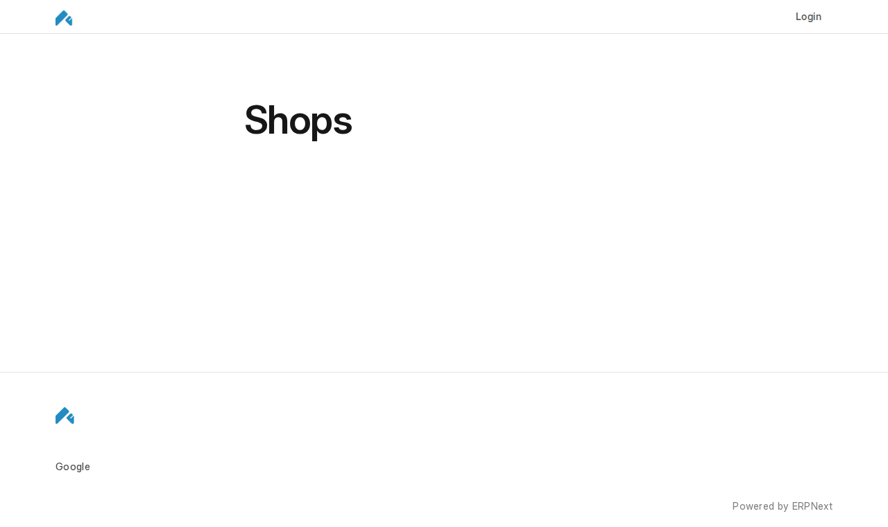
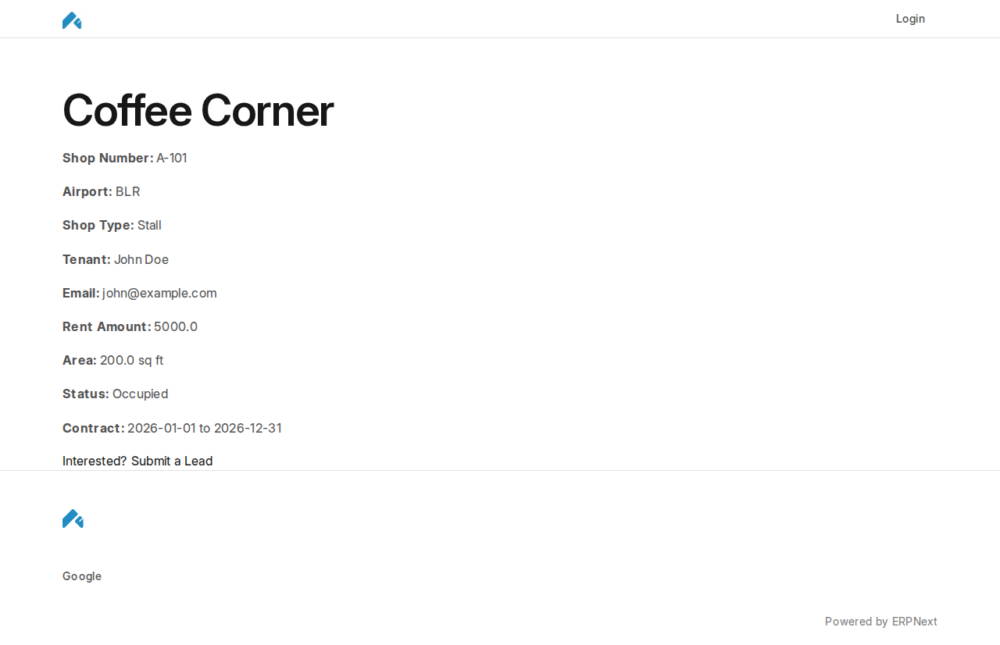

# Airplane Mode

A full-featured Frappe Framework application built as part of the Frappe Developer Certification Program.

## Tech Stack

- Frappe Framework v16
- ERPNext, HRMS
- MariaDB, Redis

## Setup

```bash
bench new-site mysite.local
bench --site mysite.local install-app airplane_mode
bench --site mysite.local set-config developer_mode 1
```

## Screenshots

### Desk


### Airlines


### Airplanes


### Flights


### Tickets


### Passengers


### Shops (Desk)


### Reports




### Web Portal






## License

MIT
